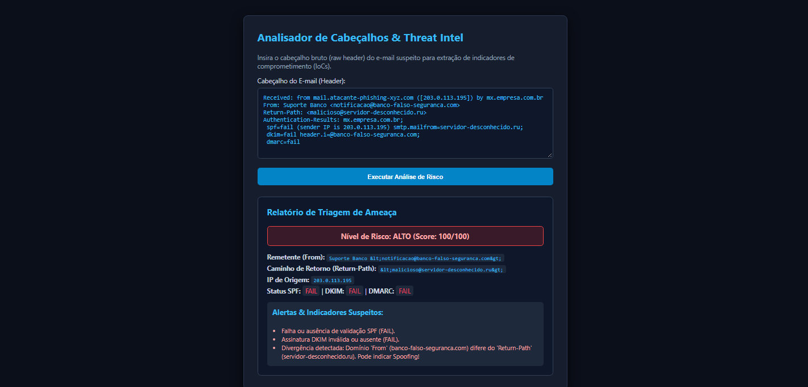

[ 🇺🇸 English ](README.md) | [ 🇪🇸 Español ](README.es.md) | [ 🇧🇷 Português ](README.pt.md)

---

#  Analisador de Cabeçalhos de E-mail & Phishing (PHP/HTML5)

Ferramenta web de Threat Intel desenvolvida em PHP e HTML5 para parsing de cabeçalhos brutos (*raw headers*), extração de Indicadores de Comprometimento (IoCs), checagem de registros SPF/DKIM/DMARC e classificação automatizada do nível de risco de phishing.

##  Propósito e Escopo
Inspirado na triagem corporativa de e-mails suspeitos e prevenção contra engenharia social (vivência na ALEGO), o sistema processa strings via Expressões Regulares (Regex) para identificar *domain spoofing* e infraestrutura de envio maliciosa.

##  Camadas de Análise Implementadas
* **Parsing via Regex (`preg_match`):** Extração automatizada do remetente (`From`), caminho de retorno (`Return-Path`), IP do servidor de origem e registros de autenticação (`SPF`, `DKIM`, `DMARC`).
* **Detecção de Divergência de Domínios:** Checagem entre o domínio de envio e o `Return-Path` para alertar sobre possível *spoofing*.
* **Motor de Score de Risco:** Algoritmo condicional que pontua e classifica o risco em **BAIXO**, **MÉDIO** e **ALTO**.
* **Sanitização de Input:** Tratamento com `htmlspecialchars()` contra injeção de scripts (XSS).

---
*Desenvolvido como parte do Portfólio de Cibersegurança para vagas internacionais.*
